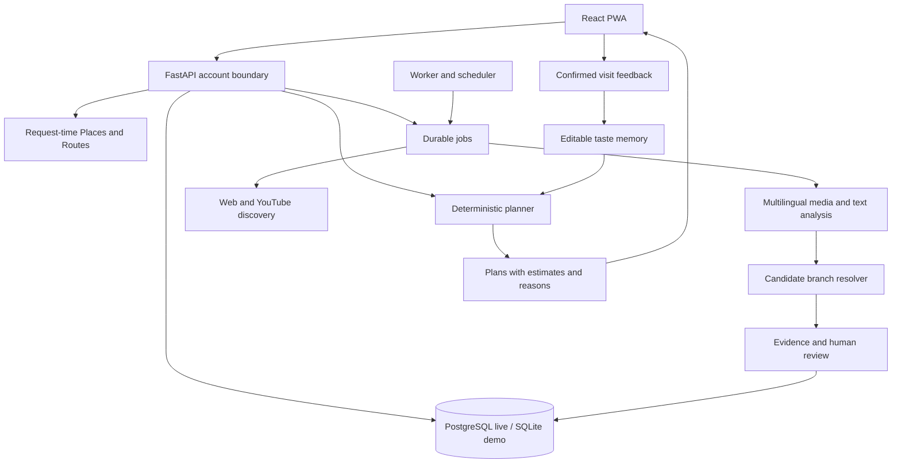

# Architecture

The [4 November investigation update](BUILD_UPDATE_2026-11-04.md) supersedes the
initial boundaries below: schema 3 adds durable investigations/tasks/sources and
source assessments; planning can use up to four stops; configured social connectors
and staged analysis now exist. Live provider/data quality remains unverified.

Confirmed: English UI, multilingual supplied content, web/PWA + admin, Coimbatore,
INR, no return planning, free access initially and external booking links.

React/TypeScript/Vite handles the PWA. FastAPI validates inputs and owns private
APIs. SQLAlchemy uses SQLite locally and PostgreSQL live. Supabase supplies live
Auth and hosted PostgreSQL. The database also owns the durable queue; Redis is
unnecessary for this first release.

The planner uses arithmetic and full opening/session windows. Model output cannot
override the budget, move the origin, invent travel, or add a return leg. It
returns one/two-stop alternatives with buffers, diversified by stop set. No match
is a valid result; constraints are not silently relaxed.

Taste starts with explicit likes/avoids and small bounded updates from food or
activity scores on confirmed visits. It is not called trained ML. A learned ranker
requires a real evaluation dataset and demonstrated improvement.

## Specialist work

The media model supplies caption, video/audio, comment, creator-context and
timestamped-clue analysis, with unknowns and next checks. These are cooperating
roles within one bounded structured analysis; multiple model calls are not
mistaken for independent corroboration. Source history reports actual accepted/
rejected reviews. Likes are engagement, not truth.

The resolver matches candidate names against owned inventory and finds Google
place IDs. Similar names are hypotheses, not branch confirmation. Multimodal video
inspection runs through the configured provider on supplied video or supported
YouTube input. There is no local every-frame vision model or claim that every
frame was inspected. All extracted claims still need factual verification.

## Evidence and publication

Schema: users, demo_sessions, venues, claims, plans, saved_venues, visits,
submissions, jobs, audit, counters. Claims retain source identity, observed/fetched
times, expiry and reason/status. Older facts cannot replace newer accepted ones.
Applied changes increment revisions so saved plans need a recheck.

Authenticated ordinary merchant/official facts can apply automatically. Large
price changes, closures, access changes, conflicts and visitor reports require
human review. A pending branch with confirmed identity can publish when all
essential current facts are accepted. Admin can explicitly publish/pause too.

Google raw place data is transient. Place IDs identify candidates; owned factual
records must come from sources that allow retention. Discovery previews expire.
Private submitted material is erasable; uploaded bytes expire after processing
or one day, including failures.

## Explicit release boundaries

- One/two-stop plans, 18 stored candidates in demo and ten provider-checked live
  candidates. This is bounded search, not an optimal global itinerary solver.
- Inventory tags and names are recognized deterministically. Unsupported specific
  requests return no supported match; mood choices handle uncertain intent. This
  is not unrestricted conversational reasoning.
- Party size, supplied companion interests and group budgets are supported;
  invitations, voting and cross-account taste blending are future extensions.
- Cinema sessions are administered schedules; live seats need a partner feed.
- Instagram links need permitted media/text or approved source access. A token
  cannot unlock arbitrary reels. Uploaded multilingual media is usable with Gemini.
- Road times and transport spending remain estimates. Current budget is never
  increased from past spending or feedback.
- Offline support opens the public shell; private data still needs a connection.

Broader coverage and trained personalization need real data and measured capacity.
These limits are visible rather than disguised as available functionality.
