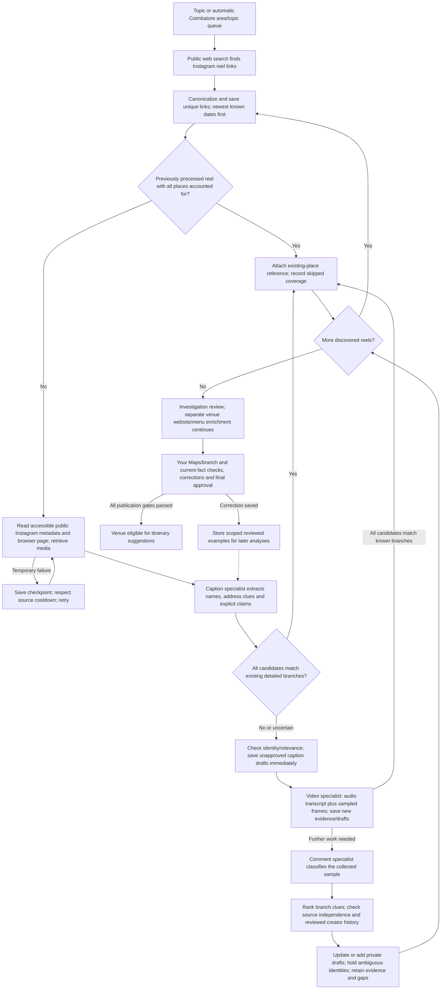

# What the Instagram agent currently does

Source/configuration walkthrough checked 8 November 2026. This documents current
implementation, not validated extraction accuracy or complete Instagram coverage.
It does not change collection settings or insert example venues.

The Python worker coordinates durable specialist jobs. The collector can fetch
while another job analyses saved evidence; GPU model calls use one analysis lane.
Current local models: Qwen3-VL 2B Instruct through Ollama for text/vision, and
faster-whisper base on CPU/int8 for speech transcription. The UI and interpreted
results are English; source content can be multilingual and needs accuracy review.

Permanent inaccessible/failed modalities leave explicit gaps rather than invented
facts. Ordinary failures have bounded retries; temporary source pacing, cooldowns
and SQLite contention preserve pending work. Source-watch/maintenance and explicit
full inspections bypass discovery-only known-place skipping.

## Step-by-step responsibilities

1. **Choose the topic.** Accept a user topic/permalink or rotate the Coimbatore
   frontier (14 areas × 12 food/entertainment topics plus relevant correction
   topics). The grid is a search strategy, not a census.
2. **Find sources.** Local public discovery uses `ddgs` web searches with month,
   year and all-time windows, plus broader-city fallback. It searches public
   Instagram links, not unrestricted authenticated Instagram feeds. Search snippets
   stay leads. All discovered sources are retained; three is the current processing
   batch size, not a top-three selection cap. This cannot establish that every
   relevant reel on Instagram was found.
3. **Order and avoid repeated work.** Check exact previously processed URLs before
   expensive recency/browser/download work when all recorded candidates remain
   usable. For other sources, obtain available publication dates and process newest
   known dates first; unknown dates remain unknown. Relevance/review history break
   date ties. Repeated source references and copied-caption origins are tracked.
4. **Collect publicly accessible post data.** HTTP metadata and anonymous Playwright
   Chromium read the target post, matching its exact shortcode to page records.
   Keep accessible caption, creator, counts, loaded comments and the target video
   reference, excluding recommended-post records. Download accepted media; join
   separately exposed clear DASH audio with FFmpeg when available. Save timestamps,
   hashes/byte receipts and access gaps. No login/challenge bypass is performed.
   Official Meta and replaceable third-party adapters are alternatives; the current
   public browser path does not require their credentials.
5. **Read the caption.** Qwen extracts explicit venue names, branch/address clues,
   dishes/activities and price statements, retaining uncertainty. It does not treat
   a title such as “new café in Coimbatore” as a venue name. Validate schema,
   attribution and relevance before updating private drafts. Save useful caption
   findings immediately. A reel item-price claim is not a verified per-person
   outing cost; the current reel-derived offering can retain an unknown numeric
   price while the claim remains in source observations.
6. **Inspect the video when needed.** FFmpeg selects endpoints and distributed/
   scene-based samples, currently eight baseline frames. Whisper transcribes
   accessible speech; Qwen examines frames in groups of up to four and interprets
   the transcript, readable lettering, menus, equipment and atmosphere clues.
   Record timestamps, unreadability and uncertainty; targeted follow-up frames and
   local reference-image matching can add clues. This is sampled inspection, not
   every-frame viewing or Google Lens. Sampling/transcription are not accuracy
   scores or branch proof.
7. **Classify comments when needed.** The current public browser target is up to
   30 loaded comments, with bounded normal expansion controls. Analyse collected
   comments in checkpointed groups of five: firsthand claim, question, promotion,
   correction, opinion, unrelated or unclear. A comment is not a verified visit;
   commenter mentions cannot create venues. This is not full comment/reply coverage.
8. **Apply the known-place shortcut conservatively.** Caption/video candidates
   must all uniquely match existing named branches with identical detailed address
   evidence (number/postcode included) and no conflicting branch tokens. A matching
   name/neighbourhood alone cannot skip a possible new branch. Unknown candidates
   in compilations keep work going. During-video recognition can stop later model
   passes/comments, although frame/audio preparation may already have happened.
   Retain the source/reference and a `coverage_complete=false` receipt. Skipping
   does not refresh facts, confirm Maps identity or judge a creator.
9. **Match location and assess evidence.** Rank existing private candidates using
   names, address/area/number conflicts and available reference-image clues. Google
   Places lookup is optional; it is currently unconfigured, and even a returned
   result alone does not confirm the branch. Separate venue-enrichment jobs gather
   public website/menu evidence; the public OSM directory is another inventory
   input, not Instagram-derived or Google-verified evidence.
10. **Assess the creator carefully.** Store available likes/views; dislikes remain
    unknown. Copy detection reduces double-counting exact caption copies. Creator
    track records use owner-entered supported/refuted review outcomes and uncertainty
    statistics. Without reviewed outcomes, reliability is unestablished. Engagement
    is not factual truth and does not independently establish a trustworthy creator.
11. **Persist/review.** Source URLs, observations, collection dates, candidate branch
    clues, uncertainty and review status remain in local SQLite. The canonical
    `identified_spots` table holds unapproved drafts; merge supported identities,
    keep distinct branches, and retain ambiguous/merged originals for review.
    Transient media is removed after processing, while raw source text/comments/
    transcripts have the existing 24-hour retention. Export/erasure applies to
    private records; offline snapshots/backups require separate deletion.
12. **Approve and learn.** Explicit branch/Maps identity review, accepted current
    essential facts and final per-location approval are needed before suggestions.
    Accepting a fact alone does not publish the venue. Your scoped corrections
    become relevant reviewed examples retrieved into later analyses; no model
    weights are automatically trained by that correction.

## Fictional example used only to explain the flow

Input: `Coimbatore sushi restaurants RS Puram`.

Imagine a Tamil reel whose caption names **Example Sushi Café**, mentions RS Puram
and says “Sushi platter ₹299.”

| Stage | What happens |
|---|---|
| Search | Find the public reel URL, save it, and check its available date. |
| Caption | Extract the written venue name, RS Puram clue and platter/₹299 statement. The area alone does not resolve a branch. |
| Immediate save | Save an unapproved candidate if relevance/identity checks allow it. Numeric price for planning stays unknown; the source price claim remains reviewable. |
| Video | Transcribe Tamil speech and inspect sampled signage/menu/seating frames. Unreadable address digits stay unknown. A visible menu price remains a source observation. |
| Comments | “Where is this?” is a question. “Visited yesterday” is a self-reported firsthand claim. “It moved branches” is a correction needing corroboration. None becomes an automatically accepted fact. |
| Branch check | Compare all available name/address clues. Conflicting RS Puram/Peelamedu evidence stays unresolved; independent Maps review is still required. |
| Second reel | Same written brand with a different address remains a separate branch candidate. A uniquely matched existing detailed branch can instead receive a retained reference and skipped-coverage receipt. |
| Review | Check the actual Maps branch/current menu/hours, correct errors and approve the location only when the publication gates are satisfied. |

The itinerary planner later uses approved locations with the user's starting point,
time, party, budget and preferences. Collecting a reel does not itself recommend
the place or prove that the creator's recommendation was correct.

## Implementation pointers

`backend/app/frontier.py`, `public_sources.py`, `browser_sources.py`,
`browser_media.py`, `research.py`, `known_spots.py`, `analysts.py`, `local_models.py`,
`comment_analysis.py`, `spots.py`, `learning.py`, `trust.py`, `jobs.py`.

This is a documentation/source/configuration trace. No new accuracy benchmark,
live connector verification, source collection, trained weights or operator
approval was performed for the walkthrough. Historical live collection receipts
and remaining quality work are in `DIRECT_INSTAGRAM.md`, `INSTAGRAM_COMPLETION.md`
and `VERIFICATION.md`; newest runtime controls are in `BULK_COLLECTION.md` and
`SQLITE_RELIABILITY.md`.
